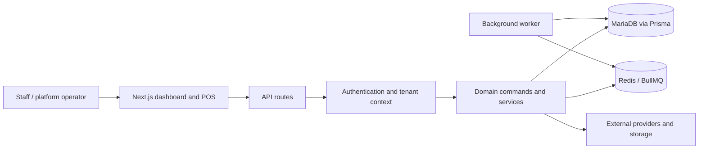
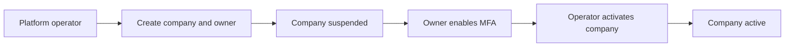
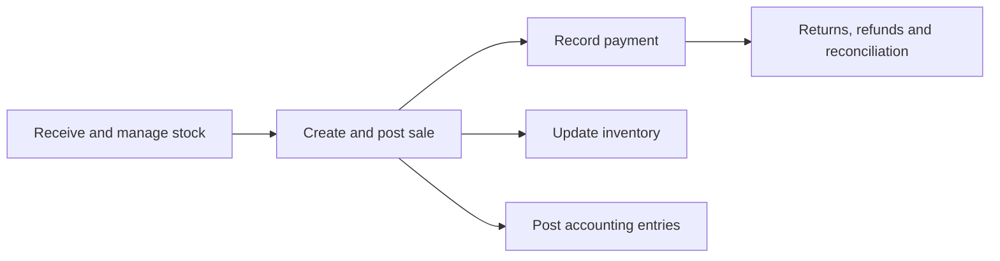

# ERP/POS

Multi-tenant retail management for Bangladesh: point of sale, inventory,
purchasing, accounting, service and warranty operations.

Built with Next.js, TypeScript, Prisma, MariaDB and Redis.

## Architecture

## Workflows

## Documentation

- [Overview, workflows, architecture and local setup](docs/overview.md)
- [Documentation index](docs/README.md)
- [Bengali user guide](docs/user-guide/bn/README.md)
- [Product blueprint](docs/master-plan/ERP_Pos_Blueprint_v4.2.md)

**Author:** [Delwar](https://delwarhossain.net)
