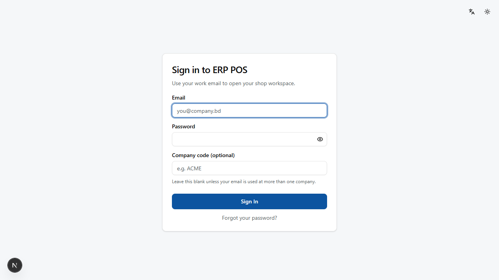

# ২. লগইন, লগআউট ও নিরাপত্তা

[সূচিপত্র](README.md)

**উদ্দেশ্য:** নিজের পরিচয়ে কাজ করা এবং দোকানের তথ্য সুরক্ষিত রাখা। **ব্যবহারকারী:** সবাই।

**শুরুর আগে:** দায়িত্বপ্রাপ্ত ব্যক্তির দেওয়া ইমেইল, পাসওয়ার্ড এবং প্রয়োজনে কোম্পানির কোড লাগবে।

## কোথায় পাবেন

`/login`, প্রয়োজনে `/mfa` বা `/mfa/setup`। পাসওয়ার্ড পুনর্নির্ধারণের পৃষ্ঠা `/reset-password`।

## ধাপে ধাপে

1. `Email` ঘরে নিজের কাজের ইমেইল দিন।
2. `Password` ঘরে পাসওয়ার্ড দিন। `Show password` ব্যবহার করলে পাশে কেউ দেখছেন কি না খেয়াল করুন।
3. `Company code (optional)` সাধারণত ফাঁকা রাখুন। একই ইমেইল একাধিক কোম্পানিতে থাকলে দেওয়া কোড লিখুন।
4. `Sign In` চাপুন। লগইনের ফল অনুযায়ী dashboard, যাচাই কোড বা সেটআপ পৃষ্ঠা আসতে পারে।
5. `Enter your sign-in code` এলে authenticator app-এর ছয় অঙ্ক দিন। `Verify code` চাপুন।
6. কাজ শেষে shell-এর `Sign out` ব্যবহার করুন। শুধু browser tab বন্ধ করা logout-এর বিকল্প নয়।

## পাসওয়ার্ড ভুলে গেলে

ব্যবস্থাপকের কাছে একবার ব্যবহারযোগ্য reset link চান। `/reset-password`-এ `New password` ও `Confirm password` পূরণ করে `Reset password` ব্যবহার করুন। বৈধ link ছাড়া submit অক্ষম থাকে। নিজে token বানাবেন না।

## উদাহরণ ও সফলতার চিহ্ন

কাল্পনিক ক্যাশিয়ার নিজের পরিচয়ে প্রবেশ করবেন; ম্যানেজারের পরিচয় ধার নেবেন না। সফল login-এর পরে `/dashboard` বা প্রয়োজনীয় MFA ধাপ আসার ব্যবস্থা সোর্সে আছে। এই পর্যালোচনায় login submit করা হয়নি।

## সাধারণ সমস্যা

- ভুল কোড: authenticator-এর পরের কোড আসা পর্যন্ত অপেক্ষা করুন।
- কোম্পানি suspended: দায়িত্বপ্রাপ্ত ব্যক্তিকে জানান; নতুন ব্যবহারকারী বানিয়ে পাশ কাটাবেন না।
- বারবার ব্যর্থতা: পুনঃপুন চেষ্টা না করে lock/rate-limit বার্তা পড়ুন।

পাসকি ব্যবস্থাপনা [সেটিংস অধ্যায়ে](17-administration.md)। পাসওয়ার্ড, QR secret, recovery code বা reset link কাউকে পাঠাবেন না।

*লোকাল অ্যাপের খালি লগইন ফর্ম। কোনো পরিচয় বা পাসওয়ার্ড পূরণ করা হয়নি।*

**যাচাইয়ের অবস্থা:** Login সফল; dashboard প্রবেশ দেখা। Reset-এর খালি form দেখা। MFA, password reset, logout বা passkey action পরীক্ষা হয়নি।

**প্রমাণ:** [লগইন](<../../../src/app/(auth)/login/page.tsx>), [MFA](<../../../src/app/(auth)/mfa/page.tsx>), [reset](../../../src/app/reset-password/page.tsx)।
